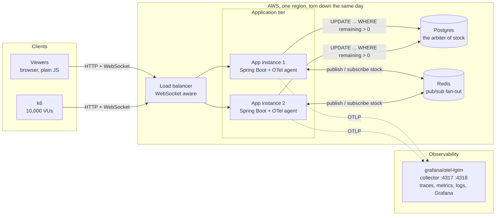
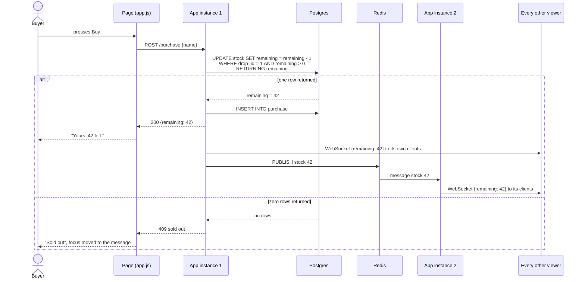

# Architecture

Two views. The first is what runs where in week 4. The second is what
happens when one buyer presses the button.

## The deployed shape



Weeks 1 to 3 are the same picture with one app instance and no Redis or
load balancer. Nothing in the code changes shape between the two. The
Redis fan-out is the only addition.

## One purchase, end to end



The decision happens inside Postgres on one statement. The application
never reads the stock, thinks, and then writes. There is no window for two
instances to both see one unit and both sell it.

## What flows over the WebSocket

One message type, one number.

```json
{ "remaining": 42 }
```

Plus two state messages: `{ "state": "open" }` at drop time and
`{ "state": "soldout" }` when the last unit goes. The page derives
everything else. This is why STOMP is not here. There is nothing to
subscribe to but the one channel.

## Ordering across instances

With Redis in the path, every instance publishes to one channel and
delivers whatever it receives, its own changes included. So all instances
deliver the same sequence. One trap, found by the fan-out test: Spring's
listener container hands each message to a new thread by default, and
deliveries overtake each other. A viewer could see 10 then 99. The
container is given a single dispatch thread so the counter only ever goes
down.

## Reconnection

A client that drops and reconnects does not need a replay. The server sends
the current `remaining` on every new connection, and the current value is
the only value that matters. This is what experiment 4 tests.

## What the load balancer must do

- Pass WebSocket upgrades through.
- Health check each instance so that experiment 3, killing one mid-drop,
  routes new connections to the survivor.
- Sticky sessions are not needed while the transport is WebSocket only.
  If SSE or long polling ever appears, they are.

## Where each experiment lives in this picture

| Experiment | Where it bites |
| --- | --- |
| 1. Headline run | k6 through the load balancer, the Postgres row at the end |
| 2. Three strategies | Inside the app instances, measured at Postgres |
| 3. Kill an instance | App instance 1 goes away, its viewers reconnect via the LB |
| 4. Drop a client's network | The Page to LB link, the reconnection path |
| 5. Move the bottleneck | Between the app tier and Postgres, where a queue would go |
| 6. Break the guard | The `WHERE` clause on the arrow into Postgres |
