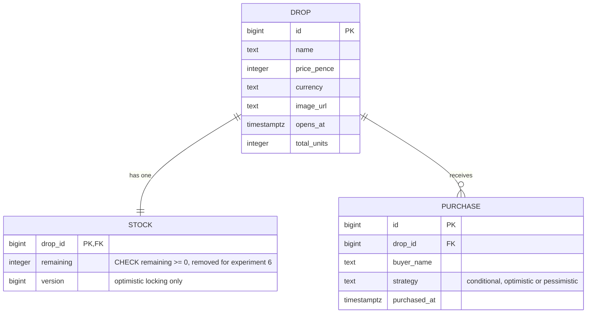

# Database

Three tables. The hot row lives on its own so that ten thousand buyers
contend for one tiny row and nothing else.



## Why three tables and not one

**`drop`** is read at page load and never written during the drop. Name,
price, image and the open time are static once configured. Keeping it apart
from the counter means the page can cache it freely.

**`stock`** is one row, two columns of data, and it is the entire contention
point. Every purchase touches this row and nothing else first. The smaller the
row, the less Postgres has to copy on each update.

**`purchase`** is the audit trail. The correctness assertion in every test and
every load run is:

```sql
SELECT (SELECT total_units FROM drop WHERE id = 1)
     - (SELECT remaining FROM stock WHERE drop_id = 1)
     = (SELECT count(*) FROM purchase WHERE drop_id = 1);
```

If that is ever false, something was sold twice or lost.

## The three write paths

**1. Conditional update.** The default and the one the README quotes.

```sql
UPDATE stock
   SET remaining = remaining - 1
 WHERE drop_id = ? AND remaining > 0
RETURNING remaining;
```

Zero rows means sold out. One statement, no transaction held open.

**2. Optimistic locking.** Read, then write guarded by the version seen.

```sql
SELECT remaining, version FROM stock WHERE drop_id = ?;

UPDATE stock
   SET remaining = remaining - 1, version = version + 1
 WHERE drop_id = ? AND version = ? AND remaining > 0
RETURNING remaining;
```

Zero rows is either sold out or a conflict. Re-read to tell which, retry on
conflict. The retry count is the conflict rate the writeup measures.

**3. Pessimistic locking.** Lock the row, then decide in the application.

```sql
BEGIN;
SELECT remaining FROM stock WHERE drop_id = ? FOR UPDATE;
-- if remaining > 0:
UPDATE stock SET remaining = remaining - 1 WHERE drop_id = ?;
INSERT INTO purchase ...;
COMMIT;
```

Correct, serialised, and every other buyer waits on the lock. The question is
what that wait costs at p99.

## The constraint that experiment 6 removes

`CHECK (remaining >= 0)` is on the table in normal running. It is a second
guard behind the `WHERE`, and it means the deliberate oversell has to remove
both to produce a negative number. The migration that drops it is kept in
the repo, clearly named, and never applied outside that experiment.

## Migrations

Flyway, SQL files only, in `backend/src/main/resources/db/migration/`.
The interesting SQL is short enough to be read as SQL and should stay that
way.
