# Folder structure

Four top-level codebases plus the documents. Each one is a different tool
and a different language, so they do not share a build.

```mermaid
graph TD
    R["dropline/"]
    R --> M["README.md, SCOPE.md, SUCCESS.md<br/>TECH-STACK.md, ACCESSIBILITY.md"]
    R --> D["docs/<br/>diagrams, mockup, results, writeup draft"]
    R --> B["backend/<br/>Java 21, Spring Boot 3, Gradle"]
    R --> F["frontend/<br/>React, TypeScript, Vite"]
    F --> FS["src/<br/>App.tsx, api.ts, useDrop.ts<br/>useAnnouncer.ts, format.ts, types.ts"]
    FS --> FC["components/<br/>DropPage, Opening, StockCounter<br/>BuyForm, StatusPanel, ProductImage, DemoPanel"]
    R --> L["load/<br/>k6 scripts"]
    R --> I["infra/<br/>Docker Compose, Terraform"]
    R --> T["tests/<br/>audit-probes.js"]

    B --> BM["src/main/java/com/jordangrieve/dropline/"]
    BM --> BA["DroplineApplication.java"]
    BM --> BD["drop/<br/>DropController<br/>DropRepository"]
    BM --> BP["purchase/<br/>PurchaseController<br/>PurchaseService"]
    BM --> BDEMO["demo/<br/>DemoController, DemoService<br/>the page's stampede and reset buttons"]
    BP --> BS["strategy/<br/>PurchaseStrategy (interface)<br/>ConditionalUpdateStrategy<br/>OptimisticLockStrategy<br/>PessimisticLockStrategy"]
    BM --> BR["realtime/<br/>StockWebSocketHandler, StockBroadcaster<br/>StockPublisher: Local | Redis"]
    B --> BRES["src/main/resources/<br/>application.yml<br/>db/migration/V1__init.sql"]
    B --> BT["src/test/java/.../<br/>PurchaseConcurrencyTest<br/>StrategyComparisonTest"]

    L --> L1["headline.js<br/>10k VUs, 100 units"]
    L --> L2["strategies.js<br/>same load, three strategies"]
    L --> L3["fanout.js<br/>WebSocket connections until it breaks"]

    I --> I1["docker-compose.yml<br/>dev: postgres, otel-lgtm"]
    I --> I3["docker-compose.cluster.yml<br/>app x2, edge, postgres, redis, otel-lgtm, k6"]
    I --> I4["edge.Dockerfile, nginx.conf<br/>static front end + load balancer"]
    I --> I2["terraform/<br/>if time allows"]

    D --> D1["DATABASE.md<br/>STRUCTURE.md<br/>ARCHITECTURE.md"]
    D --> D2["mockup/index.html"]
    D --> D3["results/<br/>numbers from every run"]
```

## Notes on the choices

**`frontend/` builds to static files** that Spring Boot serves in production
and nginx serves in Docker Compose. One origin, so no CORS, and the WebSocket
connects to the same host the page came from. In development Vite proxies
`/api` and `/ws` to the backend. The API contract the page expects is written
at the top of `frontend/src/types.ts`.

**`strategy/` is the heart of the backend.** One interface, three
implementations, chosen by a config property or a request header so the k6
script can switch between them without a redeploy.

**`realtime/` has three parts** because week 2 and week 4 are different
problems. The handler holds connections. The broadcaster pushes a number to
every connection on this instance. The Redis fan-out tells the other instances
to do the same, and it does not exist until week 4.

**`load/` is in the repo**, not in a terminal history. SUCCESS.md says numbers
that exist only in a terminal are a failure.

**`docs/results/`** is where every load run's output lands, named by date
and experiment. The writeup is built from these.

**`tests/audit-probes.js`** is copied from Postbox rather than linked, so
this repo stands alone.
